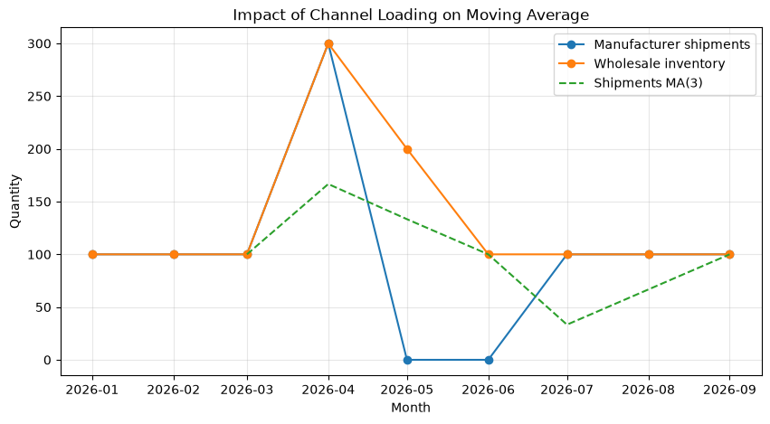

# HC08 — データの列を選んで図を描く（2026-11-19）

MacのJupyterLabで既存Notebookの描画セルを編集し、再実行した。セルの実行番号は `[29]`。凡例に卸在庫が表示され、出荷と出荷の移動平均も引き続き描かれていることを画面で確認した。

## 再現手順

1. [JupyterLabの起動手順](../docs/reproduce.md#5-open-jupyter-for-development)に従い、[inventory_analysis.ipynb](../notebooks/inventory_analysis.ipynb) を開いて **Run → Run All Cells** を選ぶ。
2. `Impact of Channel Loading on Moving Average` の描画セルで、2番目の `ax.plot` が参照する列を `df_push["consumption"]` から `df_push["wholesale_inventory"]` に替え、凡例を `Wholesale inventory` にする。
3. **Shift + Enter** で再実行する。卸在庫は4月に300、5月に200、6月に100となる。出荷と移動平均の線も表示される。

`ax.plot` に渡す列が線の値を決め、`label` が凡例の名前を決める。同じデータフレームと描画方法で、何を見せるかを変えられる。卸在庫は月末の残高、出荷は月内の数量なので、同じ数値に重なっても意味は異なる。
