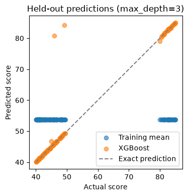

# HC08 — XGBoostで木の深さを比べる（2026-11-20）

Apple Silicon MacのDocker/JupyterLabでXGBoost 3.2.0を使用。2つの測定値から合成スコアを予測した。固定シード42で作った600行を学習用480行と評価用120行に分け、評価用の行をそろえて比較した。最初のインポートで `ModuleNotFoundError` が出た。起動中のコンテナでパッケージが利用できることを確認し、Notebookの先頭セルを再実行するとインポートが通った。

| モデル | 評価用120行のMAE |
| --- | ---: |
| 学習データの平均 | 14.31 |
| XGBoost、深さ1 | 8.80 |
| XGBoost、深さ3 | 0.66 |

深さ1はHiroさんのNotebookに表示された出力。深さ3は同じコンテナの別コンソールで、Notebookのコードを使って再現した。散布図では横が正解、縦が予測。対角線に近い点ほど誤差が小さい。

**深さ3**

**深さ1**

合成データには「2つの測定値が両方0.5以上なら加点」という条件がある。深さ1の木は1回だけ分岐するため、1本の木で両方の条件を順に扱えない。深い木は1本の中で複数の条件を組み合わせられる。このデータでは深さ3の誤差が小さかった。別のデータで有利かを判断するには、深さの比較に使っていないデータで評価する。

## 再現手順

[READMEのMac向け準備](../README.md#最初のml実習--xgboost)を実施し、[実習Notebook](../notebooks/xgboost_first_run.ipynb) で **Run → Run All Cells**。最初の結果を控えた後、`max_depth = 3` を `1` に変え、学習セルと描画セルを順に実行する。

## 学習の振り返りと再開点

ライブラリを使う理由とコードが担う処理を共有する前に、Notebookの実行と設定変更を進めた。確認できたのは実行結果。学習者は、用途や処理を理解できないまま操作しても学びにならなかったと報告した。

次は「9時までに着くため、何時に出るか」を例にする。出発時刻は予測する時点で分かり、実際の所要時間は到着後に分かる。説明用の仮の過去平均を全体42分、8時前35分、8時以降49分とし、別の3日（7:55に出て36分、8:12に出て49分、7:50に出て56分）で、全体平均と時間帯別平均を比較する。平均絶対誤差はそれぞれ9分と約7.3分。8:12出発の日は全体平均なら8:54着、時間帯別なら9:01着と予測し、出発判断が変わり得る。実際の到着は9:01だった。朝が早い日の大きな外れや、到着期限を過ぎる見落としは、平均誤差と別に見る。記録数が少ない説明例なので、数値は手法の優劣を判断する材料にはならない。人が8時という境界を決める代わりに、学習データから境界を選ぶところが決定木へのつながり。
