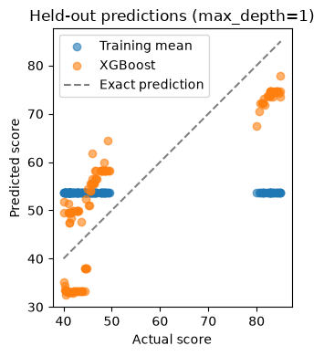

# HC08 — XGBoostで木の深さを比べる（2026-11-20）

Apple Silicon MacのDocker/JupyterLabでXGBoost 3.2.0を使用。2つの測定値から合成スコアを予測した。固定シード42で作った600行を学習用480行と評価用120行に分け、評価用の行をそろえて比較した。最初のインポートで `ModuleNotFoundError` が出た。起動中のコンテナでパッケージが利用できることを確認し、Notebookの先頭セルを再実行するとインポートが通った。

| モデル | 評価用120行のMAE |
| --- | ---: |
| 学習データの平均 | 14.31 |
| XGBoost、深さ1 | 8.80 |
| XGBoost、深さ3 | 0.66 |

深さ1はHiroさんのNotebookに表示された出力。深さ3は同じコンテナの別コンソールで、Notebookのコードを使って再現した。散布図では横が正解、縦が予測。対角線に近い点ほど誤差が小さい。

**深さ3**

**深さ1**

合成データには「2つの測定値が両方0.5以上なら加点」という条件がある。深さ1の木は1回だけ分岐するため、1本の木で両方の条件を順に扱えない。深い木は1本の中で複数の条件を組み合わせられる。このデータでは深さ3の誤差が小さかった。別のデータで有利かを判断するには、深さの比較に使っていないデータで評価する。

## 再現手順

[READMEのMac向け準備](../README.md#最初のml実習--xgboost)を実施し、[実習Notebook](../notebooks/xgboost_first_run.ipynb) で **Run → Run All Cells**。最初の結果を控えた後、`max_depth = 3` を `1` に変え、学習セルと描画セルを順に実行する。

## 学習の振り返りと再開点

ライブラリを使う理由とコードが担う処理を共有する前に、Notebookの実行と設定変更を進めた。確認できたのは実行結果。学習者は、用途や処理を理解できないまま操作しても学びにならなかったと報告した。

通勤の例は、混雑する時間帯とそうでない時間帯で所要時間が違うという既知の関係を、仮の数値でなぞるだけだった。XGBoostの仕組みや使う理由を理解するための再開点から外した。

次は既存実習の合成データで、初期予測と正解の差、最初の木の補正、それでも残った誤差に対する次の木の補正をたどる。前回変更した木の深さは1本の木が何段分岐できるかを表し、木を順に足すこととは別の仕組み。まず数値で処理を追い、XGBoostに何を任せるかを理解してからコードに戻る。
