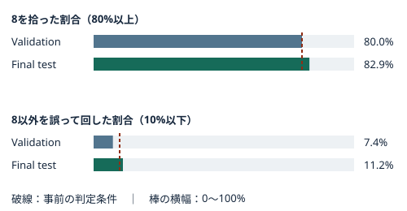

# 二値分類 — 手書き数字の「8」を確認に回す

検索用の別名：分類、二値分類、再現率、誤検出率、混同行列、分類のしきい値

[ロードマップ](../ROADMAP.md#現在の実習と次の再開点)の統計的機械学習。前の回帰では燃費のような数値を推定した。今回は画像1枚ごとに「確認に回す・回さない」を決める。

## 分類の基礎 — 混同行列

**何をするか。** 混同行列は、正解とモデルの判定の組み合わせを数える表。分類の全体正解率が高くても、見つけたいものを見逃している場合がある。この表があれば、見逃しと誤検出を別々に数え、用途に合う評価指標を選べる。行を正解、列を判定として、件数を2×2の表に並べる。

**何を計算するか。** まず「8」を陽性、「8以外」を陰性と決める。正解ラベルと判定を1件ずつ照合し、該当するマスを1つ増やす。

| 実際の数字 | 確認に回さない（陰性判定） | 確認に回す（陽性判定） |
| --- | --- | --- |
| 8以外（陰性） | TN：正しく除外 | FP：誤って回した |
| 8（陽性） | FN：見逃し | TP：正しく拾った |

手計算では、実際の数字を順に **8、3、8、6、0、9** とし、判定を **回す、回す、回さない、回さない、回さない、回さない** とする。順に TP、FP、FN、TN、TN、TN なので、TP=1、FP=1、FN=1、TN=3。

- 再現率は TP / (TP + FN) = 1/2。本物の8のうちどれだけ拾ったか。
- 誤検出率は FP / (FP + TN) = 1/4。8以外のうちどれだけ誤って回したか。
- 人が確認する総件数は TP + FP = 2。

この例は数え方を学ぶための架空の6件。見逃しと確認負担をどう評価するかが分かったところで、次の実習の条件を決める。実データの集計値も同じ4種類の数え上げで読める。

## 問いと前提

手書き数字の画像から「8」を見つけて人の確認に回す。教材上、優先するのは本物の8の見逃しを減らすこと。全件を確認に回すと人の負担が増えるので、比較前に「8を80%以上拾う」「8以外を誤って回す割合は10%以下」の両方を条件に置いた。数値は教材用の設定。実運用では見逃しの影響と確認の処理能力から決める。

復習では、すべてを「8ではない」とする方法がなぜ全体正解率では高く見えるかを説明する。別のケースで、他クラスが増えたときに、人が確認する総件数を把握するには何を数えるべきかを考える。

## 教材の説明

画像の64個の値は、8×8に並ぶ各区画のインクの量を表す。学習用の画像だけから、「8」と「それ以外」の平均画像を1枚ずつ作る。各マスの差を二乗して足すと、画像同士の距離を数値にできる。「それ以外への距離 − 8への距離」が大きい画像ほど、8の平均画像に相対的に似ている。ここでは学習側の8以外のうち、上位10%を上限に通す点数をしきい値にした。ちょうど境界の画像は送らない。

再現率の分母は本物の8、誤検出率の分母は8以外。人に回す総件数は、拾った8と誤って送ったものの合計。

## 学習・検証・最終テストの分け方

| データ | いつ使うか | この実習で決めること |
| --- | --- | --- |
| 学習 | 最初 | 2枚の平均画像と判定のしきい値を決める |
| 検証（比較用） | 候補を検討するとき | 学習時に使っていない画像で、見逃しと誤検出を確かめる |
| 最終テスト | 方法と条件を固定した後 | 別に取り置いた画像で、事前に決めた基準を満たすかを一度確認する |

本番でどんな「初めてのデータ」を扱うかを先に考える。この実習では画像単位で分けた。未知の書き手への性能が問いなら、書き手単位で分ける。検証や最終テストの正解を見てルールを変更すると、そのデータは候補の調整に使ったことになる。

## 実行で確認した事実

[scikit-learn 1.8.0 同梱データ](https://github.com/scikit-learn/scikit-learn/blob/1.8.0/sklearn/datasets/data/digits.csv.gz)を利用。元データは Alpaydin・Kaynak の [UCI Optical Recognition of Handwritten Digits](https://archive.ics.uci.edu/dataset/80/optical+recognition+of+handwritten+digits)（DOI 10.24432/C50P49、CC BY 4.0）。同梱版は元データの一部。元データはリンクで参照し、CSVの複製は配置しない。各行の最後の値が正解の数字で、残り64個を画像として利用した。gzipファイルのSHA-256は `09f66e6debdee2cd2b5ae59e0d6abbb73fc2b0e0185d2e1957e9ebb51e23aa22`。

数字ごとにシード8で混ぜ、先に学習1074枚・比較359枚・最終確認364枚に分けた。この分割は画像単位。未知の書き手への性能を主張するなら、書き手が重複しない分割が別途必要。

| 方法 | 8を拾う | 8を見逃す | 8以外を誤って回す | 8以外を回さない |
| --- | ---: | ---: | ---: | ---: |
| 何も回さない | 0 | 35 | 0 | 324 |
| 2枚の平均画像で比較 | 28 | 7 | 24 | 300 |

何も回さない場合でも、全体正解率は324/359（90.3%）。平均画像方式は再現率28/35（80.0%）、誤検出率24/324（7.4%）で、比較用データでは両条件を満たした。人に回る画像は52枚で、うち24枚は8以外。次は学習で決まった方式と境界を固定して、今回スコアを計算しなかった364枚でも両条件を満たすか一度確認する。

## 正解と判定から混同行列を作る

手計算の4マスをPythonで数える。下のコードは末尾の「実行したPythonコード」の後に続けて実行する。

1. 元データは1行が画像1枚。先に分けた比較用 `valid` は359行。 `row[-1]` で最後の列（正解の数字）、`row[:-1]` でそれより前の64個（画像の入力）を取る。
2. `actual` は「実際に8か」、`sent` は「画像だけで計算した点数がしきい値を超え、確認に回したか」。どちらも359件で同じ行順。`zip` で同じ画像の正解と判定をペアにする。
3. `cell` は手計算の表を辞書にしたもの。たとえば `(True, False)` は本物の8を回さなかったのでFN。 `Counter` が各マスの出現回数を数える。

```python
from collections import Counter

cell = {(True, True): "TP", (True, False): "FN",
        (False, True): "FP", (False, False): "TN"}
actual = [row[-1] == 8 for row in valid]
sent = [score(row[:-1]) > threshold for row in valid]
counts = Counter(cell[truth, decision] for truth, decision in zip(actual, sent))
print("shapes:", len(actual), len(sent))
print("matrix:", [[counts["TN"], counts["FP"]], [counts["FN"], counts["TP"]]])
print("recall:", counts["TP"] / sum(actual))
print("false positive rate:", counts["FP"] / (len(actual) - sum(actual)))
print("review queue:", sum(sent))
```

Macで実行すると、行は実際の8以外・8の順、列は回さない・回すの順で `[[300, 24], [7, 28]]`。実際の8の行だけを見れば、28/(7+28)=80%を拾った。8以外の行だけなら、24/(300+24)=7.4%を誤送した。人が確認する総件数は「回す」列の24+28=52枚。再現率80%以上と誤検出率10%以下に照らすと比較用では両方に届いた。取り置いた364枚は、このコードでも判定に使っていない。

## 取り置いた画像での最終テスト

目的は、比較用画像で条件を満たした方法が、新しい画像にも通用するかを確かめること。学習データから作った平均画像としきい値（表示上37.49）を固定し、同じ集計関数に比較用 `valid` と最終テスト用 `final` を順に渡した。

| 項目 | 比較用359枚 | 最終テスト364枚 | 事前条件 |
| --- | ---: | ---: | --- |
| 本物の8を拾った割合 | 28/35（80.0%） | 29/35（82.9%） | 80%以上 |
| 8以外を誤って回した割合 | 24/324（7.4%） | 37/329（11.2%） | 10%以下 |
| 人に回した件数 | 52 | 66 | — |



最終テストは誤検出率が条件を超えたため**採用保留**。329枚の8以外に対し許容できたのは32枚までで、実際は37枚。ここでしきい値を上げれば誤検出は減り得るが、見逃しも増え得る。この364枚を見て調整すれば、その調整後の独立した確認には新しいテストが必要になる。今回の数字は画像単位で分けた範囲での評価。

### 集計と描画のコード

末尾の「実行したPythonコード」に以下を追加する。 `evaluate(rows)` は正解と判定を照合して `TP, FN, FP, TN` を返す。描画では件数から割合を計算し、棒の幅に変換する。破線の位置は事前の条件（80%と10%）から決める。Macの標準Python 3.9.6で再実行し、SVGがXMLとして読み込めることを確認した。

<details>
<summary>集計コードとSVGの描画コード</summary>

```python
from collections import Counter

def evaluate(rows):
    # 各画像について (実際に8か, 確認に回すか) の組を数える。
    counts = Counter(
        (row[-1] == 8, score(row[:-1]) > threshold) for row in rows
    )
    tp, fn = counts[True, True], counts[True, False]
    fp, tn = counts[False, True], counts[False, False]
    return tp, fn, fp, tn

results = {"Validation": evaluate(valid), "Final test": evaluate(final)}
for name, counts in results.items():
    print(name, counts)

from pathlib import Path

# 横幅は0〜100%。棒は実測値、縦線は事前に決めた条件。
left, scale = 115, 3.2
chart = ['<svg xmlns="http://www.w3.org/2000/svg" viewBox="0 0 500 260">',
         '<title>手書き数字8の検出率と誤検出率</title>',
         '<rect width="500" height="260" fill="white"/>',
         '<g font-family="sans-serif" font-size="13" fill="#17283d">']
for top, title, limit, index in [
    (28, "8を拾った割合（80%以上）", 80, 0),
    (152, "8以外を誤って回した割合（10%以下）", 10, 1),
]:
    chart.append(f'<text x="14" y="{top}" font-weight="bold">{title}</text>')
    for i, (name, (tp, fn, fp, tn)) in enumerate(results.items()):
        value = 100 * (tp / (tp + fn), fp / (fp + tn))[index]
        y = top + 15 + i * 28
        color = ("#52758e", "#166b59")[i]
        chart.append(f'<text x="14" y="{y + 13}">{name}</text>')
        chart.append(f'<rect x="{left}" y="{y}" width="{100 * scale}" height="16" fill="#edf1f4"/>')
        chart.append(f'<rect x="{left}" y="{y}" width="{value * scale:.2f}" height="16" fill="{color}"/>')
        chart.append(f'<text x="{left + 100 * scale + 12}" y="{y + 13}">{value:.1f}%</text>')
    x = left + limit * scale
    chart.append(f'<path d="M{x} {top + 12}v48" stroke="#902e15" stroke-width="2" stroke-dasharray="4 3"/>')
chart.append('<text x="14" y="250">破線：事前の判定条件　｜　棒の横幅：0〜100%</text></g></svg>')
Path("digit-validation-vs-final.svg").write_text("\n".join(chart), encoding="utf-8")
```

</details>

## 本人の予想と解釈

- 実行前の予想：
- 結果を見ての解釈：

## コードと再実行

Apple Silicon MacのPython 3.9.6で実行。上記の固定版gzipファイルと下のコードを同じ場所に置き、コードを `digits.py` として `python3 digits.py digits.csv.gz` で実行できる。`score` が距離の差を返し、`threshold` が確認に回す水準を決める。scikit-learnでは同梱データを `load_digits()`、4種類の件数を `confusion_matrix(y_true, y_pred, labels=[False, True])`（結果は `[[TN, FP], [FN, TP]]`）で扱える。実行は標準Python版。

<details>
<summary>実行したPythonコード</summary>

```python
import csv
import gzip
import random
from statistics import mean
from sys import argv

with gzip.open(argv[1], "rt", newline="") as file:
    rows = [list(map(int, row)) for row in csv.reader(file)]

# 各数字を別々に混ぜ、60/20/20に分ける。
rng = random.Random(8)
train, valid, final = [], [], []
for digit in range(10):
    group = [row for row in rows if row[-1] == digit]
    rng.shuffle(group)
    n = len(group)
    train.extend(group[:3*n//5])
    valid.extend(group[3*n//5:4*n//5])
    final.extend(group[4*n//5:])

positive = [row[:-1] for row in train if row[-1] == 8]
negative = [row[:-1] for row in train if row[-1] != 8]
eight = [mean(column) for column in zip(*positive)]
other = [mean(column) for column in zip(*negative)]

def distance(pixels, template):
    return sum((a - b)**2 for a, b in zip(pixels, template))

def score(pixels):
    return distance(pixels, other) - distance(pixels, eight)

# 学習側の「8以外」で上位10%までが通る境界。境界と同点なら送らない。
negative_scores = sorted((score(row) for row in negative), reverse=True)
threshold = negative_scores[len(negative_scores)//10]
print("split:", len(train), len(valid), len(final))
print("threshold:", round(threshold, 2))
for label, rule in [("send none", lambda pixels: False),
                    ("templates", lambda pixels: score(pixels) > threshold)]:
    counts = {"TP": 0, "FN": 0, "FP": 0, "TN": 0}
    for row in valid:
        send = rule(row[:-1])
        key = ("TP" if send else "FN") if row[-1] == 8 else ("FP" if send else "TN")
        counts[key] += 1
    print(label, counts)
```

</details>
