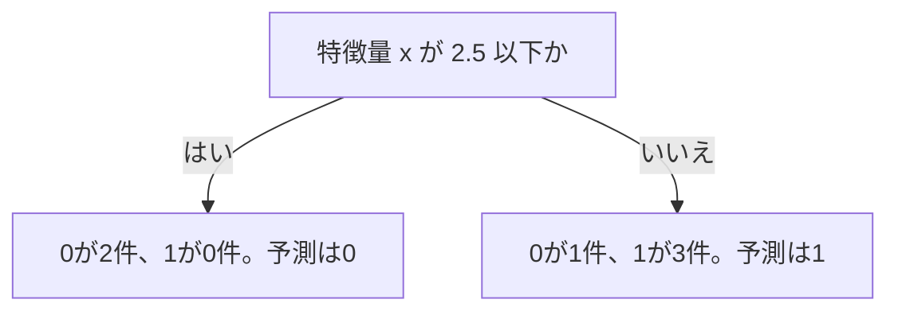

# 決定木 — 最初の分岐をどう選ぶか

検索用の別名：決定木、CART、ジニ不純度、Gini impurity、しきい値、葉

[学習マップ](../ROADMAP.md#学習状況と前提)のML。分類の評価に続き、分類のルールをデータからどう作るかを見る。

## 概念と計算

決定木は「入力の値がこの境界以下か」のような問いでデータを分け、枝の先にある葉で予測する。分類の木の利点は、どんな条件で予測が変わるか、分岐をたどって読めること。今回は分岐を1段に限定して、その条件がどう選ばれるかを確かめる。複数の入力があれば列と境界の組み合わせが候補になるが、ここでは境界の選び方に集中するため入力は1列。

ジニ不純度は、グループ内で正解がどの程度混ざっているかを表す。クラス1の割合を $p$ とすると $G=1-p^2-(1-p)^2$。全件が同じクラスなら0、半々なら0.5。分岐後は子グループの件数で重みを付けて平均し、それが最も小さい境界を選ぶ。これは学習時に分岐を選ぶ尺度。未知の例での見逃しや誤検出は、別のデータで混同行列を作って調べる。 [分類評価の復習](2026-11-23-digit-classification.md#分類の基礎--混同行列)

## 6件から分岐を作る

説明用に作った6件。入力は $x$、0と1は教師データの正解。隣り合う入力値の中点を候補にすれば、6件を分ける異なる位置を調べられる。

| 入力 $x$ | 1 | 2 | 3 | 4 | 5 | 6 |
| --- | ---: | ---: | ---: | ---: | ---: | ---: |
| 正解 | 0 | 0 | 1 | 1 | 0 | 1 |

2.5で分けると左は `[0, 0]` で $G=0$。右は `[1, 1, 0, 1]` で $G=1-(3/4)^2-(1/4)^2=0.375$。2件と4件の重みで平均して $2/6\times0+4/6\times0.375=0.25$。

| 分岐の境界 | 分岐後のジニ不純度の加重平均 |
| --- | ---: |
| 1.5 | 0.400 |
| 2.5 | 0.250 |
| 3.5 | 0.444 |
| 4.5 | 0.500 |
| 5.5 | 0.400 |



最初の分岐は2.5。葉で多数派を予測すると、学習例の $x=5$ は予測1、実際は0。分岐を増やせば学習データの混ざりをさらに減らせる場合がある。次の実習では、枝の深さを変えて、未知のデータでも改善するかを確かめる。

## 実行コードと図の生成

`rows` が元データ、`split_at` が条件に合う行を取り出す処理、`gini` が片側の混ざり具合、`weighted_gini` が分岐全体の評価。末尾は選んだ境界と左右の件数から、上の図を描くMermaidを出力する。MacのPython 3.9.6で、表の計算と図の出力を確認した。次のライブラリ実習の対応先は scikit-learn の `DecisionTreeClassifier(criterion="gini", max_depth=1)`。

```python
rows = [(1, 0), (2, 0), (3, 1), (4, 1), (5, 0), (6, 1)]

def gini(labels):
    p = sum(labels) / len(labels)
    return 1 - p**2 - (1 - p)**2

def split_at(cut):
    left = [label for x, label in rows if x <= cut]
    right = [label for x, label in rows if x > cut]
    return left, right

def weighted_gini(cut):
    left, right = split_at(cut)
    return (len(left) * gini(left) + len(right) * gini(right)) / len(rows)

values = sorted({x for x, label in rows})
cuts = [(a + b) / 2 for a, b in zip(values, values[1:])]
for cut in cuts:
    print(cut, round(weighted_gini(cut), 3))

best = min(cuts, key=weighted_gini)
left, right = split_at(best)
print("Selected:", best, left, right)

# 葉の件数と多数派から、GitHubで表示できるMermaidの図を生成する。
print("flowchart TD")
print(f'  root["特徴量 x が {best} 以下か"]')
for node, answer, labels in [("left", "はい", left), ("right", "いいえ", right)]:
    ones = sum(labels)
    zeros = len(labels) - ones
    prediction = int(ones > zeros)
    print(f'  root -->|{answer}| {node}["0が{zeros}件、1が{ones}件。予測は{prediction}"]')
```
